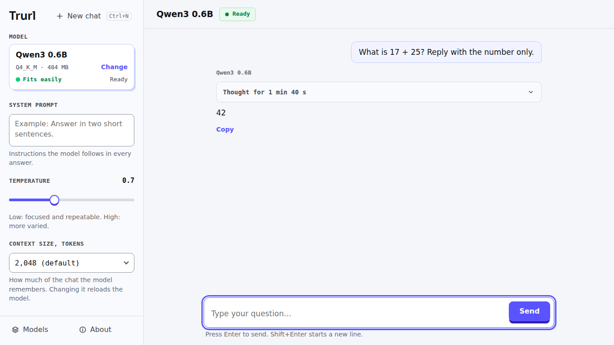
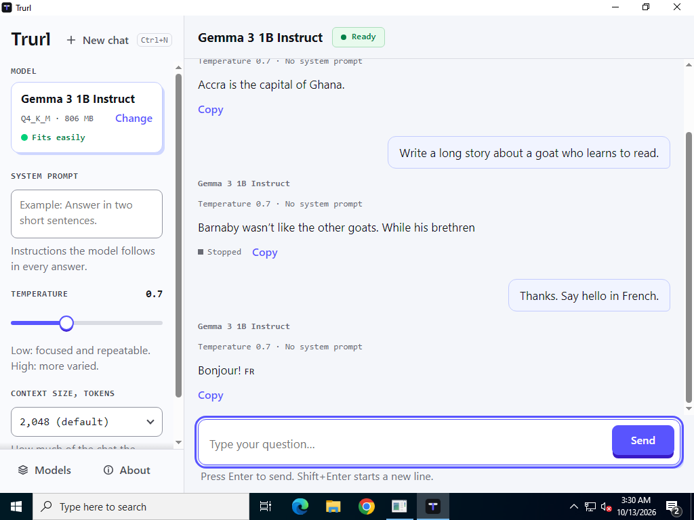
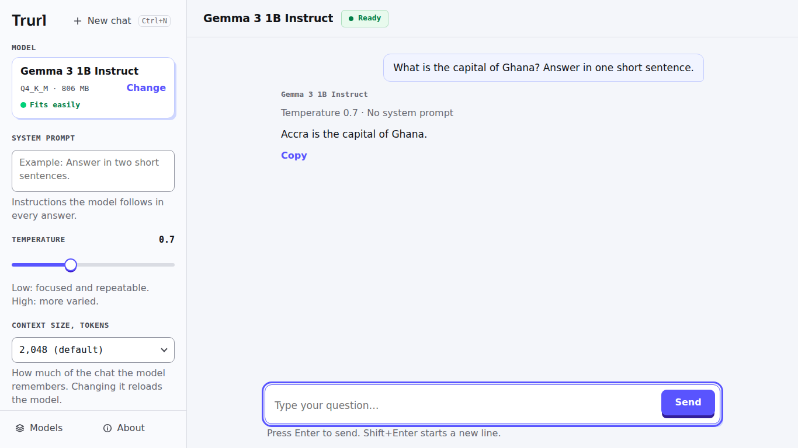
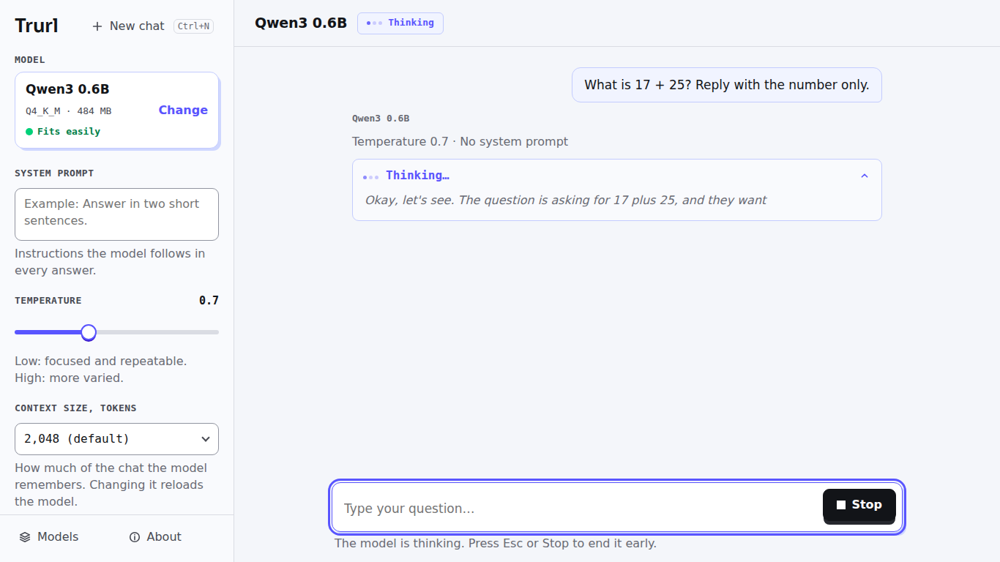
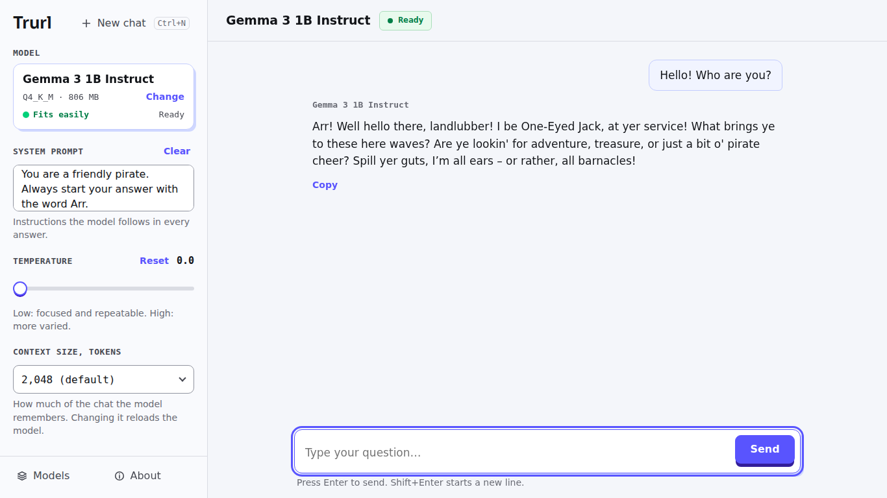
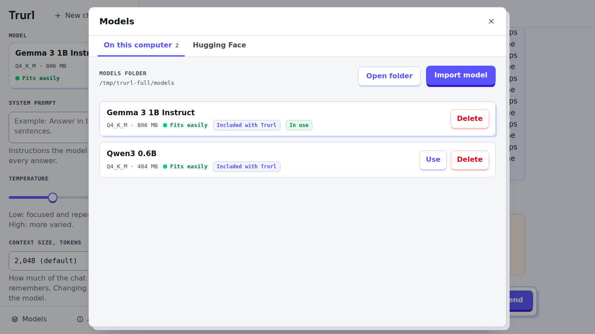
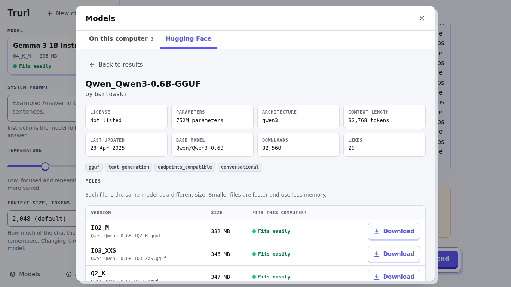
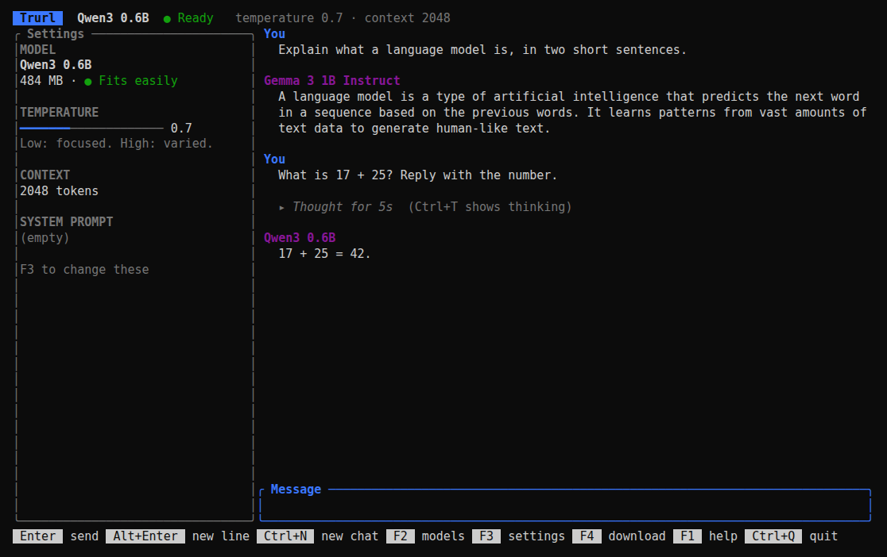

  

  <b>Run open-weight language models on your own computer, without internet, and see how they work.</b> 
  A teaching app by <a href="https://cyberiadlabs.com">Cyberiad Labs</a>. Free and open source (MIT).

  

Trurl is made for classrooms where the laptops are old, the memory is small and the
internet is slow or missing. A learner installs it from a USB stick, picks a model,
and talks to it. Everything that matters for understanding a language model is on
the screen, and nothing else:

- **The system prompt**, the instructions the model reads before every message.
- **The temperature**, from 0 (the same answer every time) to 2 (wild).
- **The context size**, how much of the conversation the model can see, and the
  message you get when it runs out of room.
- **The model's thinking**, streamed live in its own block, then folded away with
  "Thought for 12s" when the answer starts.

Nothing is hidden. Trurl adds no secret instructions, no tools, no tracking. The
model gets exactly what the learner sees.

## Contents

- [Install](#install)
- [Using Trurl](#using-trurl)
- [What it runs on](#what-it-runs-on)
- [Benchmarks](#benchmarks)
- [For teachers](#for-teachers)
- [Pinned versions](#pinned-versions)
- [Build, test, release](#build-test-release)
- [How it works](#how-it-works)
- [Licenses](#licenses)

## Install

**From a USB stick (no internet).** Open the stick and double-click
`Trurl_<version>_x64-offline-setup.exe`. The installer copies the models from the
stick's `models` folder. No administrator password is needed. To make the stick, see
[docs/USB-BUNDLE.md](docs/USB-BUNDLE.md).

**From the internet.** Download from the
[latest release](https://github.com/jbarbier/trurl/releases/latest):

| Computer | Download | Then |
|---|---|---|
| Windows 10 or 11 (64-bit) | `Trurl_<version>_x64-setup.exe` (12 MB) | Double-click. Then download models from inside Trurl, or import them. |
| Linux (64-bit) | `trurl-<version>-linux-x64.tar.gz` | `tar xzf trurl-*.tar.gz && sh trurl-*/install.sh`, then run `trurl`. If it is not found, log out and back in once, or run `~/.local/bin/trurl`. |

Until the first release is published, the Windows installer built for every change
is in [GitHub Actions](https://github.com/jbarbier/trurl/actions/workflows/ci.yml):
open the latest run and download `windows-installer-and-screenshots`.

Windows may say "Windows protected your PC" the first time: click **More info**,
then **Run anyway**. The installer is not code-signed yet; updates are signed. On a
Windows 11 computer with **Smart App Control** on, an unsigned installer is blocked
outright; [docs/USB-BUNDLE.md](docs/USB-BUNDLE.md#on-the-learners-computer) explains
the choice.

*Trurl on Windows in the automated test, with all network access blocked by the
firewall.*

## Using Trurl

### Chat

Type a message and press **Enter**. **Shift+Enter** makes a new line. The answer
appears word by word, and **Stop** (or **Esc**) cuts it short. **New chat**
(Ctrl+N) forgets the conversation. Answers are formatted (lists, bold, code), and
each one says which model wrote it, so you can compare models in one conversation.

While a model is loading, you can already type and press Send: the message goes out
as soon as the model is ready.

### Watch a model think

Reasoning models think before they answer:

- **Which models:** Qwen3, DeepSeek-R1 distills and others, detected automatically.
- **While it thinks:** Trurl shows the thinking in a grey block above the answer, live.
- **When the answer starts:** the block folds and says how long the model thought.
  Click it to read the thinking again.
- **To skip it:** type `/no_think` in a message to ask Qwen3 not to think.

The thinking is never sent back to the model with the next message, only the
answers: that is how these models are meant to be used.

### Change how the model behaves

On the left:

| Control | What it does | Default |
|---|---|---|
| Model | Which model answers. Click it for the list, with each model's size and memory fit. Switching reloads. | Gemma 3 1B |
| System prompt | Instructions the model reads before every message. Empty means none. | empty |
| Temperature | 0.0 to 2.0. Low: focused and repeatable (0 gives the same answer every time). High: more varied. | 0.7 |
| Context size | How many tokens of conversation the model can see: 256 to 8,192. Changing it reloads the model. | 2,048 |

Temperature and context size show **Reset** when they are not at their default;
the system prompt has **Clear**. When a conversation no
longer fits in the context, Trurl says: "The conversation ran out of room. Start a
new chat or increase the context size."

### Models

A model is one file in the GGUF format (`.gguf`). Click the model in the sidebar to
switch, or open **Models** to see every model on this computer, with its size and a
dot that says whether it fits in this computer's memory:

| Dot | Meaning |
|---|---|
| 🟢 Fits easily | The file is smaller than half the memory. |
| 🟠 Tight fit | Smaller than three quarters. Close other apps. |
| 🔴 Too big | Trurl asks before loading it. |

**Import model** copies a `.gguf` file from anywhere (a USB stick, a folder) into
Trurl's models folder. **Delete** frees the space.

### Download from Hugging Face

When the computer is online, the **Hugging Face** tab of the Models screen searches
[huggingface.co](https://huggingface.co) for models in GGUF format.

- **Details.** Click a result to see who made the model, its license, how many
  parameters it has, its model card, and every file.
- **Files.** Each file is the same model at a different size (its quantization, like
  Q4_K_M or Q8_0), with its memory fit. Q4_K_M is marked **Recommended**.
- **Download.** Click **Download** on a file.

Downloads survive bad connections:

- **Drops.** When the connection drops, Trurl tries again by itself and continues
  where it stopped.
- **Closing Trurl.** A download cut by closing Trurl carries on the next time Trurl
  starts. **Pause**, **Resume** and **Cancel** are always there.
- **Checked before use.** Every file is checked against Hugging Face's SHA-256
  fingerprint before it appears in the model list.

Offline, the tab says "Connect to the internet to browse Hugging Face", and
everything else keeps working.

### Updates

When online, Trurl checks for a new version once after it starts and then once a
day. If there is one, a small card says "Update available: version X.Y.Z" with what
changed, and **Update now** or **Later**. It never updates by itself and never
interrupts an answer. Updates replace the app only: your models stay. **About**
shows the version and has **Check for updates**.

### Keyboard

| Keys | Action |
|---|---|
| Enter / Shift+Enter | send / new line |
| Esc | stop the answer |
| Ctrl+N | new chat |
| Ctrl+Shift+S | hidden settings (Hugging Face token, for gated models) |

### In a terminal (Linux)

The terminal version has the same features: chat, thinking, the three controls,
models, Hugging Face search and downloads, updates, licenses. Press **F1** inside it
for its keys, or see [packaging/linux/README.txt](packaging/linux/README.txt).

## What it runs on

| | Desktop app | Terminal app |
|---|---|---|
| Windows 10, 11 (64-bit) | ✅ | not shipped |
| Windows 7, 8.1 | ❌ Microsoft's WebView2, which draws the window, ended support | not built yet |
| Linux, glibc 2.31+ (Ubuntu 20.04+, Debian 11+, Mint 20+) | not shipped | ✅ |

**CPU:** any 64-bit Intel or AMD. Trurl picks the fastest of its three model engines
when it starts:

- **AVX2:** Haswell, 2013, and newer.
- **AVX:** Sandy Bridge and Ivy Bridge, 2011 to 2012, common in second-hand laptops.
- **Compatible:** anything older. It contains no AVX instruction at all, which
  `scripts/check_cpu_isa.py` proves on every build, and it answers on an emulated
  2004 Pentium 4 (`scripts/check_cpu_emulated.py`).

If a computer cannot run the engine Trurl picked, Trurl moves down a level by itself.

**Memory:** 4 GB runs Gemma 3 1B and Qwen3 0.6B. 8 GB also runs Gemma 3 4B. No
graphics card is needed.

**Disk:** about 60 MB for Trurl, plus the models: 0.5 to 2.5 GB each.

## Benchmarks

The same model file, on the same computer, in Trurl and in the other free ways to run
it. Method and raw numbers: [docs/BENCHMARKS.md](docs/BENCHMARKS.md).

<!-- benchmarks:start -->
| | App on disk | Load time | First word | Speed | RAM, idle | RAM, answering | CPU, idle |
|---|---|---|---|---|---|---|---|
| Trurl | **54 MB** | **1.9 s** | 1.1 s | **8.3 tokens/s (7.4 to 8.9)** | 980 MB | 980 MB | **0.0%** |
| Ollama | 2,253 MB | 9.0 s | 0.79 s | **9.7 tokens/s (8.5 to 10.6)** | 951 MB | 953 MB | **0.0%** |
| llamafile | 368 MB | 2.5 s | **0.77 s** | 6.3 tokens/s (5.9 to 6.5) | **935 MB** | **936 MB** | **0.0%** |

A small cloud computer (2 AMD EPYC cores with AVX2), 2 threads, 7.8 GB RAM, no GPU. Model: `gemma-3-1b-it-Q4_K_M.gguf` for every app, context 2,048, temperature 0, answers of up to 128 tokens, median of 3 prompts x 5 rounds (the apps take turns each round). Speed in brackets: the middle half of the answers. Measured 2026-10-13 by `scripts/benchmark.py`.
<!-- benchmarks:end -->

## For teachers

**Same behaviour in every class.** Trurl never changes unless you install a new
version: the model engine, the models and every library are pinned (below).

**Hand it out on USB sticks.** [docs/USB-BUNDLE.md](docs/USB-BUNDLE.md) explains how
to make one, with the three models, and how to add your own.

**The course exercises, in Trurl:**

| Exercise | In Trurl |
|---|---|
| Temperature 0 gives the same answer twice | Slide temperature to 0.0. |
| A pre-trained model that never stops (1.1.2) | Import its `.gguf`; it runs without a chat template; **Stop** ends it. |
| Watch thinking live, stop it (1.2.3, 1.3.4) | Pick Qwen3 0.6B. On a laptop it often thinks for 1 to 2 minutes; **Stop** or **Esc** at any moment. |
| `/no_think` (1.3.4, 1.4.3) | Type it in the message; the thinking block stays empty. |
| Run out of context (1.3.2) | Set **Context size** to 256, the smallest. llama.cpp rounds any context up to a multiple of 256, so the course's 200 behaves exactly like 256. |
| Paste a whole web page (1.4.3) | Set **Context size** to 4,096 first: 2,048 tokens is about 1,500 words. |
| Warmth is a setting: two system prompts (1.4.2) | Write the first in **System prompt**, ask, press **New chat**, change the prompt, ask again. The prompt stays until you change it, for every model. |
| A study mode written as a system prompt (1.4.x) | Same box: "You are teaching me. Never give me the answer. Ask me one question at a time." |
| Copy an answer into your notes (1.4.4) | **Copy** under the answer. In the terminal app, select the text with the mouse. |
| Airplane mode | Everything works; only the Hugging Face tab asks for internet. |

**When a model will not load,** Trurl says why in plain words. For the details, the
model server's output is in `logs/llama-server.log` next to the models folder
(`%LOCALAPPDATA%\CyberiadLabs\Trurl\logs` on Windows, `~/.local/share/trurl/logs`
on Linux).

## Pinned versions

Changing any of these is a deliberate change: a pull request that updates
[`pins.json`](pins.json) and passes the evals. `scripts/check_pins.py` keeps this
table honest.

| Component | Version | Pinned by |
|---|---|---|
| llama.cpp (model engine) | v0.6.0, build b11429, commit d81235049384 | source tarball SHA-256 in `pins.json`; built by `scripts/build_llama.py` |
| Rust | Rust 1.99.0 | `rust-toolchain.toml` |
| Desktop shell | tauri 2.12.3, Tauri CLI 2.12.2 | `Cargo.toml` (`=` versions), `Cargo.lock`, the CLI version in every script |
| Terminal UI | ratatui 0.30.2 | `Cargo.toml` and `Cargo.lock` |
| Markdown | marked 18.0.14, dompurify 3.4.16 | vendored files, SHA-256 in `pins.json` |
| Build tools | CMake 3.31.6 | `pins.json`, SHA-256 checked in the release build |
| WebView2 (Windows) | Microsoft's current version | not pinnable: Windows keeps it up to date |

| Included model | File | SHA-256 (start) | Size |
|---|---|---|---|
| Gemma 3 1B Instruct (default) | `gemma-3-1b-it-Q4_K_M.gguf` from `ggml-org/gemma-3-1b-it-GGUF` | `8ccc5cd1f1b36025` | 806 MB |
| Gemma 3 4B Instruct | `gemma-3-4b-it-Q4_K_M.gguf` from `ggml-org/gemma-3-4b-it-GGUF` | `882e8d2db44dc554` | 2.49 GB |
| Qwen3 0.6B | `Qwen_Qwen3-0.6B-Q4_K_M.gguf` from `bartowski/Qwen_Qwen3-0.6B-GGUF` | `9acfc1e001311f34` | 484 MB |

Each model is pinned to a Hugging Face commit, a size and a full SHA-256.

## Build, test, release

- [docs/BUILDING.md](docs/BUILDING.md): build from source, run the tests.
- [docs/RELEASING.md](docs/RELEASING.md): publish an update that every Trurl picks up.
- [docs/USB-BUNDLE.md](docs/USB-BUNDLE.md): make the USB stick, add models to it.
- [docs/ARCHITECTURE.md](docs/ARCHITECTURE.md): how Trurl is built, and why.
- [CLAUDE.md](CLAUDE.md): the rules for changing Trurl.

## How it works

Trurl is a small Rust program around [llama.cpp](https://github.com/ggml-org/llama.cpp)'s
`llama-server`, which Trurl builds from source as one file with no dependencies:

- **Starting a model.** Trurl starts `llama-server` with the model, listening only
  on this computer (127.0.0.1) and protected by a random key, and stops it when
  Trurl closes, even if Trurl crashes.
- **Low-RAM settings.** One conversation at a time, no prompt cache, threads =
  physical cores, memory-mapped weights.
- **Chat template and reasoning.** The model's own chat template comes from its
  file. Reasoning is separated by llama-server, with a fallback for raw `<think>`
  tags.
- **Two front ends, one core.** The Windows app (Tauri, plain HTML/CSS/JS) and the
  terminal app share one core, so they behave the same.

Details in [docs/ARCHITECTURE.md](docs/ARCHITECTURE.md).

## Licenses

- **Trurl:** [MIT License](LICENSE), copyright Cyberiad Labs.
- **Models:**
  - Gemma 3: [Gemma Terms of Use](licenses/Gemma-Terms-of-Use.txt). Gemma is provided
    under and subject to the Gemma Terms of Use found at ai.google.dev/gemma/terms.
  - Qwen3: [Apache License 2.0](licenses/Qwen3-Apache-2.0.txt).
- **Software components:** llama.cpp is under the [MIT License](licenses/llama.cpp-MIT.txt).
  Every other component is listed with its license in
  [licenses/THIRD-PARTY.txt](licenses/THIRD-PARTY.txt).
- **In the app:** all of these are also in Trurl's About screen.

The app icon and logo are placeholders until the final artwork is ready.
